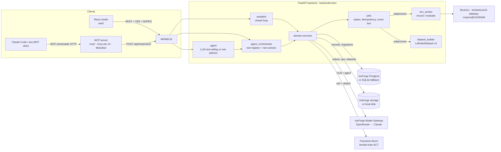

# Cortex architecture

The primary client is an agent. Claude Code or any MCP client drives the whole training loop through the MCP server. The studio is where humans watch those sessions and give the approvals only they can give.



## Agent demonstrations (GPT-6 Astra → validated IK → MuJoCo)

```mermaid
sequenceDiagram
  participant S as agent_collection_service
  participant W as agent_worker (subprocess)
  participant A as GPT-6 Astra (InsForge Model Gateway → OpenRouter)
  participant M as ManipulationSession (MuJoCo + IK)
  S->>W: scenarios (seed, cube region, lighting, offsets), budgets; API key via env only
  loop per attempt (≤16 model calls, ≤$1.50)
    W->>A: task + tool schemas + latest images (overhead with pixel grid)
    A-->>W: one tool call (e.g. propose_grasp {image_point})
    W->>M: validate (schema, workspace, IK reach, joint limits, collision sweep, timeout) then execute
    M-->>W: structured result or error; every sim step recorded (frames, state, joint-target action)
  end
  W-->>S: attempt {simulator success, trace, usage/cost, recoveries}
  S->>S: success → Episode (provenance) + quality checks; failure → diagnostics only
```

- **[sim/manipulation.py](backend/cortex/sim/manipulation.py)**: typed tools — `observe_scene`, `get_robot_state`,
  `propose_grasp`, `move_end_effector`, `set_gripper`, `verify_grasp`, `place_object`, `check_task_success` —
  plus `reset_environment`, which the collector owns.
  - *Camera-grounded:* pixels in the 480×480 overhead image are back-projected through the calibrated camera onto
    the table, then refined by lighting-invariant saturation segmentation; yaw comes from the image. Grasp checks
    use proprioception (a closed gripper that stalls open is holding something).
  - *`privileged` mode:* adds simulator poses and is always labelled.
  - *IK:* multi-start, keeping the current-pose solution when it is within tolerance.
- **[agentic/astra.py](backend/cortex/agentic/astra.py)**: OpenAI-compatible tool-calling loop with call and dollar
  budgets, cost from provider usage (or computed from published prices), recovery counting, and timeline phases.
- **[services/agent_collection_service.py](backend/cortex/services/agent_collection_service.py)**:
  - provider routing, which never substitutes another model;
  - deterministic scenario planning (matched A/B scenes via `base_seed`);
  - the standing planner budget;
  - persistence of `agent_collections` / `agent_attempts`.

## One domain layer, three callers

The GUI's REST routes, the in-studio agent, and the MCP server all end up in the same service
functions. Agents go through a single **tool registry**
([agent_orchestrator.py](backend/cortex/services/agent_orchestrator.py)): `POST /api/tools/{name}`
validates typed arguments, calls the service, and writes a `tool_audit_logs` row with the actor
(`gui`, `agent`, `mcp`, `autopilot`). The studio's Activity tab reads those rows, so you can watch a
Claude Code session act on the project live.

## Modules

| Module | Responsibility |
|---|---|
| [project_service](backend/cortex/services/project_service.py) | NL task → task spec, success criteria, condition grid, collection plan |
| [recording_service](backend/cortex/services/recording_service.py) | Runs the recorder worker, stores assets, registers episodes as each one finishes |
| [quality_analysis](backend/cortex/services/quality_analysis.py) | Timestamps, missing frames, exposure, contrast-normalized blur, action ranges, idle time (pure numpy) |
| [vlm_diagnostics](backend/cortex/services/vlm_diagnostics.py) | Keyframe contact sheet + measured telemetry → hypotheses from a fixed taxonomy |
| [analysis_service](backend/cortex/services/analysis_service.py) | Combines quality, sim-telemetry failure modes and VLM hypotheses into labelled failure clusters; human confirm/reject |
| [recommendation_engine](backend/cortex/services/recommendation_engine.py) | Ranking algorithm (below); pure and unit-tested |
| [recommendation_service](backend/cortex/services/recommendation_service.py) | Gathers evidence from the DB; adds augment/train/evaluate suggestions |
| [dataset_service](backend/cortex/services/dataset_service.py) | Immutable versions, stratified train/eval split over source episodes, image-only augmentation, lineage |
| [training_service](backend/cortex/services/training_service.py) | Propose → approve → launch → poll Slurm → fetch checkpoint; manual command bundle when no cluster |
| [simulation_runner](backend/cortex/services/simulation_runner.py) | Parallel evaluation branches with explicit seeds, Wilson 95% intervals |
| [experiment_comparison](backend/cortex/services/experiment_comparison.py) | Branch-by-branch deltas with two-proportion p-values |
| [autopilot](backend/cortex/services/autopilot.py) | Explicit, resumable state machine: TASK_REQUESTED → SCENARIO_PLANNED → AGENT_COLLECTING → EPISODES_VALIDATED → DATASET_VERSIONED → TRAINING_REQUESTED → POLICY_TRAINED → POLICY_EVALUATED → FAILURES_ANALYZED → NEXT_EXPERIMENT_SELECTED → … The weakest measured branch becomes the next targeted Astra collection |
| [hardware/](backend/cortex/hardware/) | Local, supervised-only SO-101 driver, setup, calibration and arm worker behind a safety controller (limits, velocity, workspace with the table as a floor, watchdog thread, e-stop, deadman). The studio's Robot page reaches it through `/api/hardware/*`, which only answers to localhost and needs `CORTEX_ENABLE_HARDWARE=1`. Not exposed as MCP tools |
| [agent](backend/cortex/services/agent.py) | Studio chat: OpenRouter tool calling over the registry, or a deterministic intent planner |
| [store/](backend/cortex/store/) | `Store`/`BlobStore` interfaces; InsForge REST adapters and SQLite/disk fallbacks |
| [sim/](backend/cortex/sim/) | EnvHub env wrapper (conditions, success, reward), scripted IK expert, policy loaders |
| [workers/](backend/cortex/workers/) | Subprocess entry points: `sim_worker` (record/evaluate), `dataset_builder` |

## Simulation

[sim/so101.py](backend/cortex/sim/so101.py) loads `lerobot/so101-tabletop-mujoco` at a pinned commit
through LeRobot's own EnvHub loader (`trust_remote_code`, revision-pinned). It keeps the env's scene,
Menagerie SO-101 arm, cameras, `so101_follower` units (degrees, gripper 0–100) and 30 fps position
control, and adds:

- one task cube. The other three cubes are parked off camera.
- a condition grid: cube region (left / center / right) × lighting (dim / normal / bright).
- success: the cube rests inside the box, computed with the env's own box test.
- a shaped reward used for reporting.

Every worker is a separate process with its own GL context. That gives parallel branches and keeps
MuJoCo out of the API process.

## Evidence model

| Source | Produced by | Status |
|---|---|---|
| `quality` | deterministic checks on recorded arrays | measured |
| `evaluation` | simulator telemetry per seed (`grasp_failed`, `dropped_before_target`, `released_outside_target`) | measured |
| `vlm` | model hypotheses with self-reported confidence | unverified until a human confirms |
| `coverage` | counts of accepted, quality-weighted demos per condition | measured |

## Recommendation ranking

For each condition cell *c*:

```
coverage_gap = max(0, target − quality_weighted_accepted) / target
failure_rate = mean of Beta(1+failures, 1+successes) from the latest learned-policy evaluation
uncertainty  = posterior std / std(Beta(1,1))          (1.0 means no evidence)
vlm_signal   = share of VLM hypotheses mentioning c
diversity    = 1 − max similarity to cells already picked (MMR)
score = 1.0·gap + 1.2·failure·(1−uncertainty) + 0.3·uncertainty + 0.3·vlm + 0.4·diversity
```

Cells are picked greedily until the demo budget is spent. A recommendation is `evidence_backed` when
it rests on a counted coverage gap or on at least 5 evaluation trials. Otherwise it is labelled a
`hypothesis`. Evaluation branches are mapped to cells geometrically: for example, the shifted-object
branch lands nearest the *left* region.

## Datasets

Splits are stratified by condition over source episodes with a fixed seed. Augmented copies
(brightness, contrast, color temperature, shadow) only change pixels, inherit their source's split,
and are added to train only, so augmented views of eval episodes never leak into training and
augmentation never inflates the demo count. Each version writes `meta/cortex_lineage.json`.
`dataset_episode_links` rows record the source episode, split, transform and LeRobot episode index.

## Jobs, approvals, safety

- **Job states.** Every long operation is a `Job` (`queued → running → succeeded|failed|cancelled`)
  with an idempotency key, progress events on the project SSE stream, and the subprocess handle so
  Stop really stops it. Training jobs have their own durable states (`proposed → approved → queued →
  running → succeeded|failed`) and re-attach to Slurm after a backend restart.
- **Training approval.** Training launches only after a human approval in the studio, an operator
  token, or the project's standing Autopilot policy (free jobs under a GPU-hour cap; paid jobs never).
- **Agent limits.** Agents cannot launch training themselves. `launch_training_job` is not
  agent-callable, and MCP calls without the operator token get an "approve in the studio" answer.
- **Real-robot mode.** Real-robot recording and Autopilot are refused for remote callers. Hardware
  control lives in the local [hardware/](backend/cortex/hardware/) module: off unless
  `CORTEX_ENABLE_HARDWARE=1`, reachable only from localhost, and never through MCP.
- **Tunnel restriction.** When the backend is tunneled for a hosted MCP server, remote requests can
  only reach `/api/tools` with `CORTEX_MCP_KEY`. Every other route answers only to localhost.

## Data model

Migrations: [001_init.sql](backend/migrations/001_init.sql), [002_autopilot.sql](backend/migrations/002_autopilot.sql),
[003_agent_demos.sql](backend/migrations/003_agent_demos.sql), [004_enable_rls.sql](backend/migrations/004_enable_rls.sql).

- **Tables:** `users`, `projects`, `project_members` (per-project roles and approval rights),
  `robot_configs`, `episodes`, `episode_artifacts`, `dataset_versions`, `dataset_episode_links`,
  `analyses`, `failure_clusters`, `recommendations`, `training_jobs`, `checkpoints`,
  `evaluation_runs`, `simulation_branches`, `tool_audit_logs`, `autopilot_runs`.
- **Row shape:** each entity row stores its typed Pydantic payload in `data` (JSONB) next to the
  columns used for filtering (`id`, `project_id`, `status`, `created_at`).
