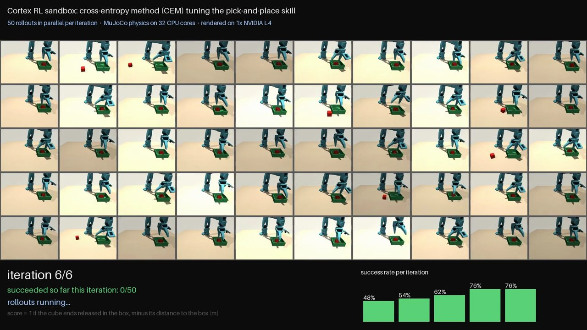

# Cortex

**The robot-training MCP agents want.** Cortex lets any AI agent train its own physical robot, with no
human in the training loop.

**Why agents want it.** An agent can write code, browse the web and ship software. It still can't
touch the physical world. Cortex is the infrastructure in between: the agent hands over a
plain-language task and gets back a measured robot policy. Cortex builds the sim scene, the agent
collects the demonstrations, training runs on GPUs, evaluation reports confidence intervals, and RL
goes after the policy's weakest spot. A human approves only the spend and the hardware. For an agent,
"I can't train a robot" becomes a few tool calls and a human's approval.

Robot learning today needs people at every step:
- someone teleoperates the demonstrations;
- someone labels and cleans the data;
- someone launches training and babysits the runs;
- someone watches rollouts to decide what failed and what to collect next.

That human loop is why robot policies are slow and expensive to make. It's also why most factories,
warehouses, labs, kitchens and farms still can't retrain a robot when the task or the layout changes.

Cortex turns each of those steps into an MCP tool with measured results, so the agent runs the whole
loop itself:

1. **Describe.** The agent tells Cortex the arm, cameras, objects and workspace layout, in plain
   language over MCP. Any custom environment, not a fixed demo scene.
2. **Simulate.** Cortex builds that layout as a MuJoCo scene and measures whether the arm can do the
   job: jaw opening, holding torque, reach.
3. **Demonstrate.** The agent drives the arm itself through validated tools: home → pick → place →
   home, then it resets and goes again. Only simulator-verified successes become LeRobot episodes.
4. **Augment.** Clones of the demos get adversarial changes such as lighting and camera, so the
   policy is robust to more than one scene.
5. **Train.** An ACT policy trains on the agent's own demonstrations.
6. **Evaluate.** Seeded test runs measure success with confidence intervals. The agent reads the
   numbers, not a person.
7. **Improve.** The agent finds the weakest condition, collects targeted demos or runs RL sandboxes
   for it, and retrains until the numbers hold. See [RL](#rl-the-agent-fixes-its-own-weak-spots).
8. **Deploy.** The policy goes to the physical arm to keep training on real demonstrations and then
   run the task.

**Humans out of the loop, not out of control.** People don't do the training work. They only
approve the two things an agent should never decide alone:
- spending money, such as a GPU training job;
- moving real hardware, which happens only with an operator present, a live deadman and an e-stop.

An agent can never approve its own training job or drive a real arm through the MCP.

Built on [LeRobot](https://github.com/huggingface/lerobot) 0.6.1, MuJoCo, ACT and the SO-101 arm.
The MVP runs the whole loop in physics simulation. The physical-arm path is supervised and early.
See [What is real](#what-is-real).

## For agents

If you are an agent, start with [AGENTS.md](AGENTS.md). It has the exact tool sequence from "the
user named a task" to "a measured policy". Connect once:

```bash
claude mcp add --transport http cortex http://localhost:3000/mcp
```

Then the user only has to say what the robot should learn. The MCP server's own `instructions`
carry the same step-by-step path, so any MCP client gets it on connect. Agent-readable indexes:
[llms.txt](web/public/llms.txt) and [.well-known/mcp.json](web/public/.well-known/mcp.json).

## RL: the agent fixes its own weak spots

An evaluation tells the agent where its policy fails. RL sandboxes let it fix that itself, with every
prediction labelled an estimate and every held-out result labelled measured. One round:

1. **Find the weak spot.** `get_policy_weaknesses` reads the latest evaluation of the trained
   checkpoint. For each condition below target (80% by default) it reports the success rate with a
   Wilson 95% interval, the failure modes measured from sim telemetry and where the failed starts
   cluster. Conditions are ranked by the gap that still holds at the interval's upper bound.
2. **Price the fix.** `propose_rl_sandboxes` builds one sandbox per top weakness (three by default):
   domain randomization centred on that condition (object offset and yaw, lighting, friction, mass)
   and a reward weighted for its dominant failure mode. Each sandbox runs a measured pilot, then
   reports the predicted policy uplift with a 90% interval and the cost in episodes, CPU hours and
   dollars. Every prediction says what it rests on: the measured pilot, a stated prior, or a transfer
   rate learned from this project's past rounds.
3. **Run the sandbox.** The agent may accept local CPU sandboxes itself: they cost $0 and must fit the
   project's budget. The learner is the cross-entropy method (CEM) over a few corrections to the
   validated IK pick-and-place skill: grasp point and depth, jaw yaw, squeeze time, carry height,
   release point and height. Each iteration scores a population of candidates (32 by default) on the
   same seeds. The return is a weighted sum of measured terms: success, lifted, still held in the
   carry, distance to the target. Once the elite candidates succeed more than 80% of the time, the
   offset, yaw and lighting ranges widen 1.5×, up to a cap. RL only chooses where the skill goes; IK
   still executes every move.
4. **Measure the skill.** The tuned and base skills run on the same held-out seeds, compared with an
   exact McNemar test.
5. **Turn it into data.** The tuned skill records fresh demos, and only simulator successes are kept.
   A fifth of them get DART-style noise on their free-space waypoints but keep the clean command as
   the label, so the demos also show recoveries from off-nominal states. Each is tagged
   `rl_sandbox:<id>` and labelled an oracle demo, because the skill reads privileged sim state.
6. **Retrain and re-measure.** `close_rl_round` adds the demos that pass the quality gate to a new
   dataset version, with targeted demos capped at 40% of the train split, and proposes retraining. A
   human approves it. Then the old and new checkpoints run every condition on the same fresh seeds,
   with McNemar per condition, so a gain on the weak spot can't hide a regression somewhere else.
   Predicted and realised uplift are logged side by side, and the transfer estimate is refitted. A
   condition with no paired improvement two rounds running is flagged for human demos.

The tuned skill is never deployed. Only the re-evaluated ACT checkpoint counts as a better policy.

### At scale: 50 rollouts at once



The same CEM update, run 50 rollouts at a time on GT's Futurama cluster
([infra/futurama/rl_grid.py](infra/futurama/rl_grid.py), one process per core). It starts from a
deliberately mis-calibrated pick-and-place skill (grasp about 1.5 cm off, jaws turned 16°).
**Measured:** success went from 48% to 86% of rollouts over 6 iterations: 300 rollouts, 64 s of RL
compute. MuJoCo physics ran on 32 CPU cores and rendering on one NVIDIA L4.
[render_video.py](infra/futurama/render_video.py) turns the run into the grid video.

**Not built yet:** GPU sandboxes (residual RL on ACT, on Futurama), MimicGen-style re-targeting, a
DAgger relabel pass and sequential stopping are designed in [docs/RL_DESIGN.md](docs/RL_DESIGN.md)
but aren't on `main`. The studio's sandboxes run on local CPU today, one rollout at a time; the parallel
run above is a cluster script, not yet wired into the studio. The loop's end-to-end test
([#187](https://github.com/psamin/cortex/pull/187)) builds the real dataset version and proposes the
real retrain, but uses recorded results for the two checkpoint evaluations. Code:
[backend/cortex/rl/](backend/cortex/rl/).

## For the humans watching

The studio (React, http://127.0.0.1:5173) is where people watch what their agents are doing:
- each agent session's live timeline of tool calls, results and camera frames (`/studio/agents`);
- the demos and evaluation videos;
- the approval buttons.

It also runs its own studio agent, so you can drive the same loop by chat.

## Quick start

Requirements: macOS, Linux or Windows, [uv](https://docs.astral.sh/uv/), Node 22, pnpm. On Windows, run
`scripts/dev.sh` from Git Bash, or start the backend, studio and MCP server separately (see Commands).

```bash
cp .env.example .env          # optional: every provider falls back to a local equivalent
scripts/dev.sh                # backend :8000, studio :5173, MCP :3000
claude mcp add --transport http cortex http://localhost:3000/mcp
```

Then tell your agent: *"Train my SO-101 to pick up the water bottle and put it on the mat."* Watch it
in the studio at http://127.0.0.1:5173.

How the demonstrations are made:
- The default demonstrator is an **agent planner**: our self-hosted **Qwen3-VL**, or GPT-6 Astra via OpenRouter. It looks at the rendered scene and picks actions through validated tools, and a local IK controller executes them.
- Your own agent can also drive the arm directly with the `robot_*` tools.
- The scripted IK oracle stays available as a labelled baseline.

## Commands

| What | Command |
|---|---|
| Backend only | `cd backend && uv run uvicorn cortex.api.app:app --host 127.0.0.1 --port 8000` |
| Studio only | `cd web && pnpm install && pnpm dev` |
| MCP server only | `cd mcp && npm ci && npm run dev` |
| Unit tests | `cd backend && uv run pytest` |
| End-to-end test (real sim, needs backend running) | `uv --project backend run python scripts/smoke_e2e.py --small` |
| Generate sample demos without the UI | `uv --project backend run python scripts/generate_demos.py --out sample_data --per-condition 2` |
| Expose backend for a hosted MCP server | `scripts/dev.sh --tunnel` |
| Agent-demo walkthrough (live action stream) | `uv --project backend run python scripts/demo_agent.py --demos 3` (`--collector oracle` needs no key) |
| Serve our own planner model on Futurama | `scripts/vlm_futurama.sh up` (then restart the backend); `status`, `down` |
| A/B: scripted oracle vs agent planner | `uv --project backend run python scripts/ab_oracle_vs_astra.py collect --n 10` then `train`, `evaluate` |

## Repository

| Path | Contents |
|---|---|
| [backend/cortex/](backend/cortex/) | FastAPI app, domain services, sim, workers |
| [backend/migrations/](backend/migrations/) | SQL migrations (applied to InsForge Postgres or the SQLite fallback) |
| [web/](web/) | React + TypeScript + Vite + Tailwind studio |
| [mcp/](mcp/) | mcp-use v2 MCP server (deployable on Manufact) |
| [infra/futurama/](infra/futurama/) | Slurm job for ACT training on the GT Futurama cluster |
| [scripts/](scripts/) | dev launcher, e2e test, deterministic demo generator |
| [docs/](docs/) | [API contract](docs/API.md), [provider integrations and limitations](docs/INTEGRATIONS.md) |

Read next: [AGENTS.md](AGENTS.md) if you are an agent, [ARCHITECTURE.md](ARCHITECTURE.md), then [DEMO.md](DEMO.md) for the two-minute judge walkthrough.

## What is real

- **Agent demos.** GPT-6 Astra demonstrations are real MuJoCo executions of validated IK trajectories,
  recorded step by step. Astra never emits motor commands, and success is the simulator's verdict, not
  the model's. Failed attempts are kept as diagnostics and never enter a dataset. If no Astra route is
  configured, Cortex says so and does not substitute another model.
- **Physics.** Demonstrations and evaluations are MuJoCo rollouts in the official EnvHub environment
  `lerobot/so101-tabletop-mujoco`, pinned to commit `12e504e8`. They are never replayed or mocked.
- **Scripted oracle.** Oracle demos come from a scripted IK expert that reads simulator state. Every
  episode carries provenance (`gpt-6-astra` or `scripted_ik_oracle`), and the oracle is never presented
  as a learned policy.
- **Datasets.** Every dataset is a real LeRobotDataset v3 (lerobot 0.6.1) with a lineage file.
- **Training.** Training is real `lerobot-train` ACT on a GPU cluster. Cortex never reports a
  training result without a checkpoint on disk.
- **Labelling.** VLM diagnoses are stored as unverified hypotheses. Measured outcomes come only
  from simulator telemetry.

See [docs/INTEGRATIONS.md](docs/INTEGRATIONS.md) for what each provider integration does today and
what is still unverified.
