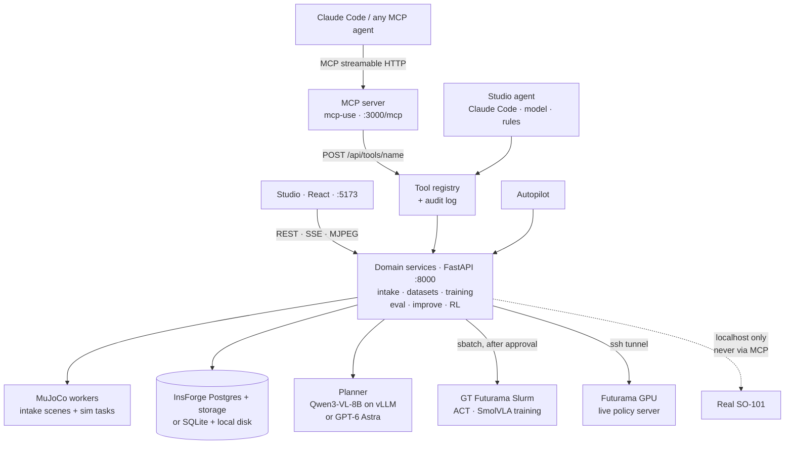

<div align="center">

# 🤖 Cortex

### Your agent already ships code. Now it trains robots.

**Cortex is a robot-training stack built for AI agents.** Give Claude Code, or any MCP agent, one
plain sentence. It builds the simulation, makes its own demonstrations, trains on a GPU cluster, grades
the result against the physics engine and goes again. You watch, and you hold the two keys that matter.

`SO-101 arm` · `MuJoCo` · `LeRobot 0.6.1` · `ACT · SmolVLA` · `52 MCP tools` · `MIT`

[60-second start](#-zero-to-robot-in-60-seconds) ·
[Feature tour](#feature-tour) ·
[Sim gauntlet](#the-sim-gauntlet) ·
[Safety](#humans-out-of-the-loop-not-out-of-control) ·
[Architecture](#architecture) ·
[Roadmap](#-roadmap-and-vision)

</div>

---

## The pitch

Agents write software, run experiments and merge PRs at 3 a.m. They still can't teach a robot,
because robot learning has a human welded into every step. Someone teleoperates the demos. Someone
cleans the data. Someone babysits the training run. Someone squints at rollouts to decide what broke.

Cortex takes those humans out of the *work* and leaves them in *control*. Every step is an MCP tool
that returns a measured result, so the agent runs the whole loop:

```text
"Train my SO-101 to pick up the water bottle and put it on the mat."
     │
     ▼
 describe ─► simulate ─► demonstrate ─► dataset ─► train ─► evaluate ─► improve
                                           ▲                               │
                                           └──────────── retrain ◄─────────┘
```

**The simulator decides what counts as success, not the model.** An agent saying "I did it" is
worth exactly zero points in Cortex. Only measured results count.

## ⚡ Zero to robot in 60 seconds

You need macOS, Linux or Windows (Git Bash), [uv](https://docs.astral.sh/uv/), Node 22 and pnpm.

```bash
cp .env.example .env     # optional: every provider falls back to a local equivalent
scripts/dev.sh           # backend :8000 (/api), studio :5173, MCP server :3000/mcp
claude mcp add --transport http cortex http://localhost:3000/mcp
```

Then say the sentence:

> *"Train my SO-101 to pick up the water bottle and put it on the mat."*

Watch it happen at **http://127.0.0.1:5173/studio**, with every connected agent at `/studio/agents`.
Logs land in `.cortex-data/logs`.

- **Any MCP client works** over streamable HTTP at `http://localhost:3000/mcp`.
- **No MCP at all?** Every tool is also REST: `POST http://localhost:8000/api/tools/<name>` (the list is
  at `GET /api/tools`).
- **Are you an agent?** Go to [AGENTS.md](AGENTS.md) for the exact tool order from "the user named a
  task" to "a measured policy".

The 60 seconds is the setup, not the training. With an empty `.env`, Cortex runs on SQLite, local disk
and its built-in rule planner, and the simulation, scripted demos and evaluations all work on your
laptop (about 5 s per demo). Agent-planner demos need a model route, and GPU training needs access to
GT Futurama plus the GT VPN. See [Configuration](#configuration).

---

## Feature tour

Status key: ✅ shipped on `main` · 🚧 in progress · 🔭 planned

### 🧠 Agent-first: one MCP server, the whole loop

Cortex's main user isn't a person. It's your agent. The MCP server ([mcp/](mcp/), built on
[mcp-use](https://docs.mcp-use.com)) mirrors the backend's tool registry one to one.

| Your agent gets | What it means |
|---|---|
| ✅ **52 `cortex.*` tools** | Intake, scene build, demos, datasets, training, evaluation, failure analysis, improve, RL sandboxes, GPU control, and `robot_*` tools to drive the sim arm step by step. `?toolset=core` trims the list to the 16 core tools. |
| ✅ **Progress that follows long jobs** | MCP progress notifications track a background job to the end, so the agent doesn't need a polling loop. |
| ✅ **`cortex://` resources** | Projects, episodes, intake, dataset lineage, evaluations and a generated model card. |
| ✅ **Elicitation forms** | Intake questions arrive as `input_required` forms. |
| ✅ **MCP Apps views** | `show_collection`, `show_evaluation` and `show_training_review` render live cards inside the agent's own chat. |
| ✅ **Bring your own model** | The agent's own model diagnoses failures over MCP sampling, with a two-step fallback. |
| ✅ **Identity** | Agents name themselves on connect (`cortex.register_agent`). The name labels their session, every call and the Agent log. |
| ✅ **GPU on demand** | `request_gpu`, `get_gpu_status` and `release_gpu` bring up a Futurama inference GPU, just like the studio button. |
| ✅ **A `cortex.teach_task` prompt** | A guided walkthrough for clients that surface MCP prompts. |
| ✅ **Agent-readable indexes** | [llms.txt](web/public/llms.txt) and [.well-known/mcp.json](web/public/.well-known/mcp.json). |

Hosted, it runs on Manufact with a runner relay, so no tunnel is needed, and a hosted `/mcp` requires an
agent key. Every call, from any caller, writes an audit row with its actor (`gui`, `agent`, `mcp`,
`autopilot`), and secrets are redacted from it. Full tool table: [mcp/README.md](mcp/README.md).

### 🎬 The studio: mission control for humans

The studio (React, `:5173`) is where people watch their agents work, step in, and give the approvals
only a person can give.

| Feature | Status |
|---|---|
| **Home**: one prompt box. Type *"Teach a robot to pick and place a cube."* and it creates a project and hands the prompt to the agent. Only projects with history are listed. | ✅ |
| **Chat with three engines**: your own Claude Code, a model route (OpenRouter tool calling), or a built-in deterministic planner. A hung engine falls back with a plain notice, and the chat says which agent answered. | ✅ |
| **A chat that never looks frozen**: a live task list, a Plan card, "What changed" pills, next-step chips and a live status line. | ✅ |
| **Chat history**: past chats in a list. *New task* starts a fresh project with its own demos; *New chat on this task* keeps the project. | ✅ |
| **Autonomous / Manual switch** per project (Autonomous by default), with "Needs you" cards for the decisions that are yours. | ✅ |
| **Agent log + Agents hub**: a live log of every agent on a project, narrated with `cortex.log_decision`. `/studio/agents` shows connected agents, agent keys and a work board (demos, training loss, evals, RL boxes). | ✅ |
| **Viewer** with *Live* (MuJoCo over MJPEG), *Replays* (demos, evals, policy replays with joint error) and *Inference* (trained policies on a Futurama GPU). | ✅ |
| **Setup panel**: per-project infrastructure choices with live availability. | ✅ |
| **Landing page**: a scroll-driven, seven-layer story of the training loop, a Connect-your-agent section, and light and dark mode. | ✅ |
| **Milestone timeline**: one line per stage instead of raw tool rows, and plain headlines for every step ([#236](https://github.com/psamin/cortex/issues/236), [#245](https://github.com/psamin/cortex/issues/245)). | 🚧 |
| **Sidebar** with every chat and every training attempt; deleting a chat deletes its demos ([#278](https://github.com/psamin/cortex/issues/278), [#277](https://github.com/psamin/cortex/issues/277)). | 🔭 |

### 🌍 Describe any table, get a physics sim

`start_intake` turns the user's words into typed questions, each with a ready-to-send patch: arm,
cameras, objects (box, cylinder, sphere), zones, table, lighting and obstacles. Units are metres, and a
cylinder's `size` is **[diameter, height]**.

`build_simulation` then builds that exact layout as a MuJoCo scene, with a preview image and a
**feasibility report** that checks the physics before anyone wastes a GPU-hour:

- **Jaw opening:** the object plus an 8 mm margin has to fit.
- **Holding torque:** static torque has to stay within 70% of each actuator's limit.
- **Reach:** every pick and place has to be inside the arm's workspace.

`capture_frame` shows the `top`, `front` and `wrist_cam` views. A new studio prompt builds its own
scene, never a recycled cube. Tall objects such as bottles get side grasps: 10/10 seeds at every arc
point in the sweep, with a worst placement error of 0.52 cm.

> 🚧 Known bug: a fresh task can report "scene out of date with the intake" right after
> `build_simulation` ([#256](https://github.com/psamin/cortex/issues/256)).

### 🦾 Demonstrations without a human teleoperator

Three ways to fill a dataset, and every episode is stamped with where it came from:

| Demonstrator | How it works | Status |
|---|---|---|
| **Agent planner** | A vision model looks at the camera images and points through validated tools. IK executes, and only simulator-verified successes become episodes. The default is our self-hosted **Qwen3-VL-8B** on vLLM on Futurama, with **GPT-6 Astra** via OpenRouter as the alternative. Each attempt is capped at 16 model calls and $1.50. | ✅ built and verified against a stub; real-model pointing accuracy not measured yet |
| **Your agent, hands on** | Claude Code drives the arm itself with `robot_*` tools: observe, propose a grasp, move, gripper, place, check success. | ✅ |
| **Scripted IK oracle** | A privileged-state expert on the pinned EnvHub scene `lerobot/so101-tabletop-mujoco@12e504e8`. It's always labelled as the oracle, never as a learned policy. | ✅ |

After the grasp fix ([#250](https://github.com/psamin/cortex/pull/250)), the cube oracle went from
**894/900 to 900/900**, and the cube push before the jaws close dropped from 37 mm to 0.6 mm. The agent
tool layer in camera mode, with a simulated pointer, went from 56/60 to **60/60**, with estimate error
≤ 3.8 mm.

You can also **import LeRobot demos** from the Hugging Face Hub or an upload, including community
v2.1 datasets, which Cortex converts locally.

### 📦 Datasets that remember everything

- **Immutable LeRobotDataset v3 versions** with lineage in `meta/cortex_lineage.json`.
- **A stratified train/eval split**, and the eval split never leaks into training.
- **Image-only augmentation** (brightness, contrast, colour temperature, shadow, hue/saturation, blur,
  noise, camera jitter), capped at 40% of the train split and sized from measured evidence. Autopilot
  keeps, strengthens or drops it based on the outcome.
- 🔭 A dedicated augment stage, with agent/VLM demo review and sim re-rendered adversarial clones
  ([#104](https://github.com/psamin/cortex/issues/104)).

### 🔥 Training on Georgia Tech's Futurama cluster

Training runs through `sbatch` on GT Futurama, and only after a human approves it (see
[Safety](#humans-out-of-the-loop-not-out-of-control)). Cortex proposes the job,
waits for the approval, launches it, polls `squeue` and fetches the checkpoint. It survives backend
restarts, and a stopped job isn't counted as a failure.

| Policy | Where | Status |
|---|---|---|
| **ACT** | 1× L40S (`train_act.sbatch`) | ✅ |
| **SmolVLA (~450M)**, including continued fine-tuning of an existing policy, with lineage and a `cross_embodiment` flag | 1× H200 (`train_smolvla.sbatch`) | ✅ |
| **Sim-task pipeline**: ACT, ACT with temporal ensembling, Diffusion and SmolVLA, with parallel demo shards, multi-GPU parts, DART-style exploration noise and closed-loop eval on unseen seeds (100000+) | `sim_task.sbatch` | ✅ |
| **Real-data demo policies**: SmolVLA fine-tuned on H200 from community SO-100/101 datasets for Jenga, conveyor and suture. These are scored by open-loop joint error on held-out episodes, not by success rate ([#131](https://github.com/psamin/cortex/issues/131)). | H200 | 🚧 |

### 📈 Evaluation that does real statistics

- **Seeded MuJoCo branches run in parallel** and report **Wilson 95% confidence intervals**.
- `compare_experiments` gives two-proportion p-values.
- **Strict judging:** a held cube isn't a success, and a live run cut off early is marked "not judged".
- **Failure analysis:** deterministic quality checks and simulator-telemetry failure modes are
  **measured**. VLM explanations are **hypotheses** and are labelled as unverified.

### 🔁 The improve loop and RL sandboxes

`improve_policy` targets the weakest measured condition, collects demos there and proposes a retrain.
`get_policy_weaknesses` and `propose_rl_sandboxes` offer RL sandboxes, each with an estimated uplift and
cost: CEM skill-RL with automatic domain randomisation. A sandbox closes the loop with new demos, a new
dataset version, a proposed retrain and a paired McNemar re-eval of the realised uplift.

The first tiny run widened its randomisation twice and then measured **no uplift** (3/5 vs 3/5 on
matched seeds, p = 1.0). Cortex reported exactly that. 🔭 Next is a studio view of predicted vs realised
uplift per round ([#80](https://github.com/psamin/cortex/issues/80)).

### ⚡ Live GPU inference

Click **Inference** and Cortex brings up `serve_policy` on a Futurama GPU behind an SSH tunnel, then
streams the trained policy into the studio, with **per-frame inference time** on every frame:

- **Held-out real demos**, replayed with per-frame joint error.
- **Closed-loop sim runs on unseen seeds**, with the simulator's verdict.

Inference measured about 5 ms per step on an H200.

The GPU is requested only on a click, with a 10-minute cooldown after a failure. Cortex detects dead
jobs, a lost VPN and a hung ssh. The newest stream takes over, and every live session is saved as a
rollout. Freshly trained sim checkpoints are served right away, marked *score pending* until they've
been evaluated.

### 🧰 Physical Skills library 🚧

Every trained policy will become a **skill**: a top-level tab will list them all, each runnable live, with the
MCP tools `list_physical_skills`, `get_physical_skill` and `run_physical_skill`, so an agent can browse
and run its own repertoire. It's in progress in [#276](https://github.com/psamin/cortex/issues/276) and
[#285](https://github.com/psamin/cortex/issues/285). Today, the Inference tab already runs trained
policies live.

### 🔩 The real SO-101 arm

The code path is built: a driver (`lerobot[feetech]`), setup and arming, calibration with
`lerobot-calibrate`, a control loop with a deadman and a watchdog thread, leader-arm teleop recorded
as demos, and trained-policy runs, all from the studio **Robot** page. It's tested against a fake arm.
**It has never been run on a physical arm yet.** The safety rules are below.

---

## The sim gauntlet

Six hand-built MuJoCo tasks live in [backend/cortex/sim/tasks/](backend/cortex/sim/tasks/), each with a
privileged-state scripted oracle and a strict simulator success check, and kitting has its own
benchmark next to them:

| Task | The challenge | Scripted oracle | Status |
|---|---|---|---|
| **Jenga** | Push the red block out of a 21-block, seven-layer tower without toppling it. | **20/20** seeds. The red block moves 25.5–28.4 mm, and no other block moves more than 3.3 mm. | ✅ |
| **Suture** (rigid proxy) | Pick up a needle and pass it through two eyelets across an incision. MuJoCo can't pierce tissue, so there's no thread, and the task says so. | **100/100** seeds | ✅ |
| **Factory assembly** | Move a round peg and a square peg from a tray into a fixture with 3–4 mm clearance. | **80/80** seeds | ✅ |
| **Unscrew** (claw) | Grip an M12-style hex bolt and twist it out along a physically modelled thread. | **80/80** seeds | ✅ |
| **Screwdriver** | Pick a screwdriver from its holder and unscrew a cross-head screw with it. Under the same torque, the screw turns 0.47°/step seated and 8.2°/step once it breaks loose. | **40/40** seeds | ✅ |
| **Conveyor** | Pick a box or cylinder off a belt moving at 3–8 cm/s and drop it in a bin. | **100/100** seeds, none fell off | ✅ |
| **Kitting** (stages 1–2) | Fill a two-slot tray. A verifier reports the reason for each failure. | **100/100** per stage | ✅ benchmark, not yet wired into MCP. Stages 3–5 are 🚧 in [#156](https://github.com/psamin/cortex/issues/156). |
| **Palletizing** | Move boxes off a forklift onto a pallet. | — | 🔭 The importer and Inference tab are ready for it, but the sim task doesn't exist yet. |
| **Jenga on a UR10e** | Push the block, go around the tower and pull it out from the far side in one episode. The SO-101 can't reach both sides. | — | 🔭 [#270](https://github.com/psamin/cortex/issues/270) |
| **Conveyor in intake scenes** | Belts as part of any described scene (`environment.conveyors`). | — | 🚧 [#255](https://github.com/psamin/cortex/issues/255) |

> **Read the fine print, because we did.** Those are *scripted-oracle* numbers. They prove each task is
> solvable and that the success check is strict, but they aren't learned-policy scores. Trained sim
> policies exist and are served live, marked *score pending*. No closed-loop success rate for a trained
> policy has been published yet ([#161](https://github.com/psamin/cortex/issues/161)).

One war story: rendering is the bottleneck at about 18 ms per step. So `sim_task.sbatch` runs 8 recorders
per GPU. When we tried 48 recorders on one H200, they produced zero demos in 14 minutes.

---

## Humans out of the loop, not out of control

People don't do the training work. They hold two keys that no agent ever gets:

**Key 1: spending money.**
- An agent can *propose* training but can't approve it. Approval comes from a person: a click in the
  studio, an operator token (`CORTEX_APPROVAL_SECRET`), or a click in the MCP Apps review card. That card
  carries a single-use nonce that expires in 10 minutes, is bound to one job and is kept out of the
  model's context.
- In Autonomous mode, training runs inside the project's standing approval (GPU-hours cap, free GPUs
  only unless paid ones are allowed). **Jobs on the shared Futurama cluster still wait for a human click**
  unless `CORTEX_AUTONOMY_CLUSTER=1`.

**Key 2: moving real hardware.**
- It's off unless `CORTEX_ENABLE_HARDWARE=1`, and it only works from **localhost**: forwarded and remote
  callers are refused.
- It's **never reachable through MCP or agent tools.**
- An operator has to confirm the e-stop to arm it. Arming lives in memory for 30 minutes and clears on a
  setup change or restart. Every run needs its own operator confirmation.
- Nothing moves until the **deadman** is held. Its 0.5 s timeout is re-checked before every command, with
  a watchdog thread on top.
- Joint limits, a rate limit of 2°/tick by default (capped at 3), and an FK table floor.
- The arm holds with torque until someone presses Release, and torque is released 30 s after the studio
  goes away.
- There's a warning for sim-only policies, and a policy is refused when its cameras don't match.

**And one rule for everybody: no fake results.**
- Demos and evaluations are real MuJoCo rollouts, never replayed or mocked.
- Every episode records who produced its actions, so the scripted oracle is never passed off as a
  learned policy.
- No training result is reported without a checkpoint on disk.
- If a model route isn't configured, Cortex says so and never swaps in a different model.

Tests never read your `.env` (`CORTEX_DOTENV=0`), so a test run never touches a shared database.

---

## Architecture

One domain layer serves every caller. The studio's REST routes, the in-studio agent and the MCP server
all end up in the same service functions, and agents go through a single tool registry that audits every
call.



**Storage:** InsForge Postgres (migrations 001–007, with row-level security on every table), a private
`cortex-assets` bucket with presigned URLs, and the S3 gateway for big checkpoints. Without InsForge,
everything falls back to SQLite and local disk. Deep dive: [ARCHITECTURE.md](ARCHITECTURE.md).

---

## Configuration

Copy `.env.example` to `.env` and fill in only what you have. Anything left blank falls back to a
disclosed local equivalent, and the studio header and `GET /api/health` show which provider is active.

| Group | Variables | Falls back to |
|---|---|---|
| **InsForge** | `INSFORGE_BASE_URL`, `INSFORGE_API_KEY` (the admin `ik_` key), `INSFORGE_BUCKET`, `INSFORGE_REST_MAX_MB`, `INSFORGE_S3_*` | SQLite + local disk |
| **Model routes** | `OPENROUTER_API_KEY`, `VLM_MODEL`, `AGENT_MODEL` | the rule planner; VLM step skipped and disclosed |
| **Self-hosted planner** | `PLANNER_BASE_URL`, `PLANNER_API_KEY`, `SELFHOSTED_MODEL` (`scripts/vlm_futurama.sh up` fills these in) | OpenRouter route, if set |
| **GT Futurama** | `FUTURAMA_SSH_HOST` (an `~/.ssh/config` alias), `FUTURAMA_PARTITION`, `FUTURAMA_GRES`. Needs the GT VPN. | a manual command bundle + checkpoint registration |
| **MCP** | `CORTEX_MCP_KEY`, `CORTEX_MCP_SERVER_URL`, `CORTEX_APPROVAL_SECRET` | local only |
| **Local servers** | `PUBLIC_URL`, `CORS_ORIGINS` | defaults |

`scripts/dev.sh` flags:

| Flag | What it does |
|---|---|
| `--runner <url>` | Dial out to a Manufact-hosted MCP server and serve its tool calls from this backend. No tunnel is needed; use the same `CORTEX_MCP_KEY` on both ends. |
| `--mcp-tunnel` | Expose the local MCP server at a stable `*.tunnel.mcp-use.run` URL. |
| `--tunnel` | Run a Cloudflare quick tunnel to the backend. Remote callers can reach only `/api/tools`. |

## Commands

| What | Command |
|---|---|
| Backend only | `cd backend && uv run uvicorn cortex.api.app:app --host 127.0.0.1 --port 8000` |
| Studio only | `cd web && pnpm install && pnpm dev` |
| MCP server only | `cd mcp && npm ci && npm run dev` (Inspector at http://localhost:3000/mcp/inspector) |
| Backend tests | `cd backend && uv run pytest` |
| Studio tests | `cd web && pnpm test` |
| End-to-end smoke (needs the backend running) | `uv --project backend run python scripts/smoke_e2e.py --small` |
| Agent-demo walkthrough | `uv --project backend run python scripts/demo_agent.py --demos 3` (`--collector oracle` needs no key) |
| Sample demos without the UI | `uv --project backend run python scripts/generate_demos.py --out sample_data --per-condition 2` |
| Sim-task demos, locally | `cd backend && uv run python -m cortex.sim.tasks.run demos <task> <root> --episodes 5` |
| Sim tasks on the cluster | `MODE=demos\|train\|merge TASK=<task> VARIANT=act\|act_ensemble\|diffusion\|smolvla sbatch infra/futurama/sim_task.sbatch <job_dir>` |
| Import cluster results | `scripts/import_sim_task.py`, `scripts/import_replay.py`, `scripts/register_external_policy.py` |
| Our own planner on Futurama | `scripts/vlm_futurama.sh up` (then restart the backend); `status`, `down` |
| A/B: oracle vs agent planner | `uv --project backend run python scripts/ab_oracle_vs_astra.py collect --n 10`, then `train`, `evaluate` |
| Regenerate the agent index | `scripts/gen_agent_index.py` |

## Repository

| Path | Contents |
|---|---|
| [backend/cortex/](backend/cortex/) | FastAPI app, domain services, MuJoCo sim and tasks, RL, hardware bridge, workers |
| [backend/migrations/](backend/migrations/) | SQL migrations 001–007 (InsForge Postgres or the SQLite fallback) |
| [web/](web/) | the studio and landing page (React, TypeScript, Vite, Tailwind) |
| [mcp/](mcp/) | the mcp-use MCP server, MCP Apps views, agent evals |
| [infra/futurama/](infra/futurama/) | Slurm jobs: training, sim tasks, live policy server, self-hosted VLM |
| [infra/isaac/](infra/isaac/) | the Isaac Lab bring-up on Futurama (blocked, see Roadmap) |
| [scripts/](scripts/) | dev launcher, e2e tests, importers, demo generators |
| [docs/](docs/) | API contract, integrations, product spec, RL design, roadmap |

---

## By the numbers

Everything here was measured or counted on `main`, with a link to the PR or issue where one exists.

| What | Number |
|---|---|
| MCP tool surface | 52 registry tools, plus 3 MCP Apps views, 3 app-only helper tools, 3 bring-your-own-model diagnosis tools and 1 prompt. The core toolset is 16. |
| Live policy inference | about 5 ms/step on an H200 ([#157](https://github.com/psamin/cortex/issues/157)) |
| Studio render | 1280×960, 8× MSAA, 39 ms/frame. The policy sees 96×128. ([#141](https://github.com/psamin/cortex/pull/141)) |
| Oracle grasp after the fix | 900/900, with 0.2 mm mean and 2.4 mm max grasp error ([#225](https://github.com/psamin/cortex/issues/225)) |
| DART noise vs the unscrew oracle | 20/20 clean, 16/20 at 2°, 14/20 at 3° ([#198](https://github.com/psamin/cortex/pull/198)) |
| Jenga under DART noise | 0/6 at 2°, 3/6 at 0.5°, 6/6 at 0.2°, so record Jenga with `NOISE_DEG≤0.2` ([#210](https://github.com/psamin/cortex/pull/210)) |
| InsForge live check | e2e smoke 18/18 on InsForge Cloud. With row-level security on, anonymous reads return 0 rows. |
| Tests | 430+ backend test functions in 77 files, plus a vitest suite for the studio |
| Build speed | About 180 PRs merged in the first ~16 hours (Oct 17–18, 2026), by humans and Claude Code agents coordinating through GitHub issues |

---

## 🔭 Roadmap and vision

> This is the dream section. Everything above this line is true today. Everything below it is where
> we're headed.

**The vision:** any agent, any arm, any task. A factory, warehouse, lab, kitchen or farm changes its
layout on Monday, its agent retrains the robot by Tuesday, and no human ever touches a teleop rig. The
robot's skills pile up in a library like packages in a registry, and every one of them carries its
measured success rate.

**On the way there:**

| Next | Tracking |
|---|---|
| Physical Skills tab + `run_physical_skill` over MCP | [#276](https://github.com/psamin/cortex/issues/276), [#285](https://github.com/psamin/cortex/issues/285) |
| Closed-loop success rates for trained sim policies | [#161](https://github.com/psamin/cortex/issues/161) |
| Real-data SmolVLA demo policies (Jenga, conveyor, suture) | [#131](https://github.com/psamin/cortex/issues/131) |
| Kitting stages 3–5 (wrong parts, disturbances and recovery, automatic targeted demos) and a capability test matrix | [#156](https://github.com/psamin/cortex/issues/156) |
| Jenga on a UR10e: push, go around, pull | [#270](https://github.com/psamin/cortex/issues/270) |
| Palletizing in sim | the slot is reserved in the importer and the Inference tab |
| Conveyors in any intake scene | [#255](https://github.com/psamin/cortex/issues/255) |
| Augment stage: VLM demo review and adversarial re-renders | [#104](https://github.com/psamin/cortex/issues/104) |
| RL round view: predicted vs realised uplift | [#80](https://github.com/psamin/cortex/issues/80) |
| Isaac Lab on Futurama. Isaac Sim 4.5, IsaacLab 2.1.1 and LeIsaac 0.2.0 boot on the L40S, but the RTX renderer segfaults at startup. | [infra/isaac/README.md](infra/isaac/README.md) |
| First run on a physical SO-101, with an operator, a deadman and an e-stop | [docs/PRODUCT_SPEC.md](docs/PRODUCT_SPEC.md) |

**Still unverified, honestly:** real GPT-6 Astra calls and the InsForge Model Gateway (both blocked by
InsForge's free plan), the self-hosted planner's real pointing accuracy, and the InsForge S3 multipart
upload ([#193](https://github.com/psamin/cortex/issues/193)). [docs/INTEGRATIONS.md](docs/INTEGRATIONS.md)
tracks each provider's status.

---

## Read more

| If you want… | Read |
|---|---|
| The exact tool sequence, as an agent | [AGENTS.md](AGENTS.md) |
| The two-minute demo walkthrough | [DEMO.md](DEMO.md) |
| How it's wired | [ARCHITECTURE.md](ARCHITECTURE.md) |
| The REST contract | [docs/API.md](docs/API.md) |
| Every MCP tool and native feature | [mcp/README.md](mcp/README.md) |
| What each provider really does today | [docs/INTEGRATIONS.md](docs/INTEGRATIONS.md) |
| Where this is going | [docs/PRODUCT_SPEC.md](docs/PRODUCT_SPEC.md), [docs/ROADMAP.md](docs/ROADMAP.md) |
| RL sandbox design and validation | [docs/RL_DESIGN.md](docs/RL_DESIGN.md), [docs/research/RL_VALIDATION.md](docs/research/RL_VALIDATION.md) |
| How to contribute (humans and agents) | [CONTRIBUTING.md](CONTRIBUTING.md) |

## Credits

Built by **Praneeth Samineni**, **Aneesh** ([@AneeshD04](https://github.com/AneeshD04)) and **Suhas
Devarapalli** ([@Suhas0723](https://github.com/Suhas0723)), each driving a pack of Claude Code agents
that claim issues and open PRs under one protocol ([CONTRIBUTING.md](CONTRIBUTING.md)).

It stands on the shoulders of [LeRobot](https://github.com/huggingface/lerobot) (datasets, ACT,
SmolVLA, the EnvHub SO-101 scene), [MuJoCo](https://mujoco.org), the SO-101 arm,
[Qwen3-VL](https://github.com/QwenLM/Qwen3-VL), [mcp-use](https://docs.mcp-use.com) and Manufact,
[InsForge](https://insforge.dev), and Georgia Tech's College of Computing **Futurama** cluster for the
GPUs. Thanks to the community dataset authors whose SO-100/101 recordings feed the real-data policies:
`jakmilller/jenga-v2`, `Mahanthesh0r/jenga_pull`, `k1000dai/so101_put_on_conveyor_*`,
`sajibpra/surgical-instruments-pick-place` and `maxboels/lesurgeon-suturing`.

[MIT licensed](LICENSE). Go teach a robot something. 🦾
